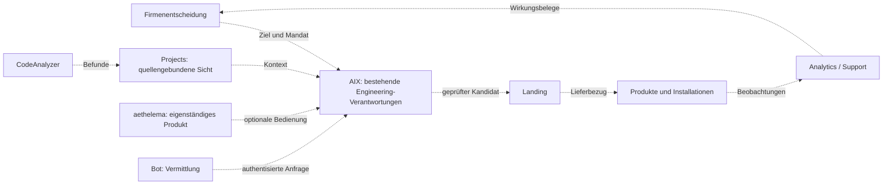

# Architektur eigenständiger Produkte und gemeinsamer Nachweise

Status: Reviewentwurf. Die Standalone-Vorgabe des Nutzers ersetzt die frühere Forderung, aethelema zuerst an einen gemeinsamen AIX-Durchstich zu binden.

## Grenzen

Jedes Produkt besitzt seinen eigenen fachlichen Kern und vorhandenen Zustand. Integrationen erfolgen über schmale, versionierte Verträge. Nicht verfügbare Nachbarsysteme dürfen nur die von ihnen abhängige Funktion beeinträchtigen. Bestehende Standalone-Ausführungswege bleiben zulässig; ein AIX-Auftrag wird nicht rückwirkend zur Voraussetzung aller lokalen Arbeit.

aethelema verantwortet seine Kommunikationsfunktionen und Nutzerführung. Flutter, Rust und Swift nach vorhandenen Verantwortungen einsetzen; keine dreifache Geschäftslogik und kein Rewrite aus Vereinheitlichungsgründen. AIX/Copilot entwickelt seine eigenen Fähigkeiten unabhängig weiter. Gemeinsame Integrationstests ergänzen die jeweiligen Produkttests.

Projects projiziert Herkunft und Stand. Bestehende Authority-, Conductor-, Verify-, Landing- und Produktverantwortungen bleiben getrennt. Neue Graphen, Oberflächen oder Agenten erhalten daraus keine Schreibrechte.

## Zielbeziehungen

Die gestrichelten Kanten zeigen zu prüfende Zielverträge, keine pauschal bestätigte Integration.

## Nachweisidentitäten

Produkt, Anforderung, Quellkandidat, Build, Artefakt, Gate-Subject, Freigabe, Installation und Beobachtung typisiert verknüpfen. Task, Attempt und persistente Effect-ID zusätzlich unterscheiden. Ein Quellhash verhindert keine doppelten Außenwirkungen. Vorhandene IDs wiederverwenden; keinen universellen Ersatzschlüssel erfinden.

## BOM und Betriebszustände

eBOM = Engineering; hBOM = Hardware/Substrat; mBOM/POM = Fertigungsplan mit Produkt-/Substratbindung; pBOM = Production/as-built; rBOM = Release; sBOM/SBOM = Software; svcBOM = Service. hBOM ist laut Quellenabgleich bereits deklariert; Durchsetzung ist separat zu prüfen. Ein Provenienzbuch ist nicht automatisch ein vollständiger Produktpass.

Konzeptmodi localAIOnly, hybrid und cloudAIOnly mit bestehenden Enums quellengebunden abgleichen. CLOUD_ALLOWED ist nicht gleich cloudAIOnly. Inferenzort, Netzwerk, Werkzeugausführung und Datenfreigabe getrennt behandeln, einschließlich transitiver KI-Aufrufe.

## Steuerung und Übernahme von Agentenarbeit

Eine Projektsteuerung benötigt priorisierte Ziele, begrenzte Aufträge, Verantwortliche, Ressourcen, Änderungen, Qualität und Wirkung. Sie ist weder eine Liste von Chats noch eine neue Ausführungszentrale.

Eine Claude-/Codex-Übergabe referenziert den bestehenden Auftrag, Owner/Besitzgeneration, erlaubte Dateien, Basis und Kandidat, laufende Prozesse, Belege, offene Entscheidungen und nächsten Schritt. Vor Schreibübernahme müssen alte Schreibrechte und Prozesszustand geklärt sein. Ein Promptkopieren ist keine Rollenübernahme.

Fables und ChatGPTs Rückmeldungen als versionierte Befunde behandeln: bestätigt, widerlegt, bereits behoben oder offen. Zustimmung zählt nicht als unabhängige Reproduktion. Keine Architekturänderung allein aufgrund von Mehrheit der Modelle.

## Gemeinsame Produktdefinition und Verantwortungen

AETHEL verbindet menschliche Ziele mit nachvollziehbaren, geprüften und
betriebenen Produkten und führt deren tatsächliche Wirkung zurück. Drei reale
Szenarien strukturieren diese Definition: ein Produkt weiterentwickeln, eine
Änderung gemeinsam liefern und ein Problem im Betrieb nachweislich schließen.
Standalone-Produkte bleiben eigenständig nutzbar.

| Verantwortung | Zuständiges bestehendes Organ | Grenze |
|---|---|---|
| Nutzen, Portfolio, Priorität und Budget | Company-Funktionen | Keine technischen Prüfsiegel |
| Anforderungen, Produktkonfiguration, Qualitätsfälle und Beziehungen | Projects und bestehende PLM-/Qualitätsfunktionen | Keine zweite Auftragsausführung |
| Aufträge, Revisionen, Rechte, Ressourcen und Ausführungszustand | AIX und seine zuständigen Fachorgane | Kein Erfolgsstatus allein aus Chatbehauptungen |
| Verstehen, Bedienung und Erklärung | AIX Copilot | Liest Fachzustände; Mutationen nur über deren autorisierte Wege |
| Isolierte Änderungskandidaten und Herkunft | Bestehende Kandidatenverträge; aethelGit im Ausbau | Erteilt keine eigene Landungsfreigabe |
| Urteil-/Gatebindung und kontrollierte Übernahme | Verify-/Gate-Verträge und Landing | Prüfungen an den tatsächlich geltenden Kandidaten binden |
| Speicherung und Rekonstruktion | Bestehende produktive Speicher; Helix experimentell | Helix ist keine Voraussetzung der ersten Lieferung |
| Build, Installation und Wirksamkeit | Zuständige Produkt-/Release-/Betriebswege | Gelandeter Code ist kein Installationsnachweis |

Origin, Polarion und PLM dienen als Vergleich für benötigte Fähigkeiten. Sie
begründen keine mehrfachen kompletten Nachbauten. Jede benötigte Fähigkeit
wird einem bestehenden Organ, einem Vertrag und einem überprüfbaren
Nutzerablauf zugeordnet; ein Repositoryname allein definiert keine neue Hoheit.

Die durchgängige Beziehung ist:

**Bedarf → Anforderung/Abnahme → AIX-Auftrag → Änderungskandidat → Prüfung →
Landung → Build/Installation → Wirksamkeit → Qualitäts-/Produktentscheidung.**

Anforderung, Auftrag, Versuch, Kandidat, Build und Installation behalten ihre
jeweils vorhandenen IDs. Verknüpfungen tragen Quelle, Revision und Geltungsbereich.
Nicht vorhandene Bindungen bleiben offen; Namen oder ausgewählte Dateien
beweisen keine Identität. Projects und Copilot verwenden dieselben Projektionen
und erklären deren Alter und Grenzen. Eine Darstellung allein ersetzt keinen
funktionierenden Übergang.

Für jede Schnittstelle müssen Produzent, Consumer, zuständige Wahrheit,
Schema/Revision, Identitätsbindung, erlaubte Aktionen, Fehlerverhalten und
Prüfbeleg im bestehenden Vertrag auffindbar sein. Diese Dokumentation erfindet
keinen zweiten Executor, keine Registry und keinen neuen Laufzeitstatus.
